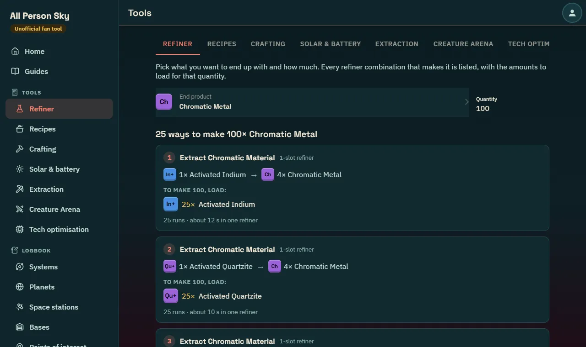
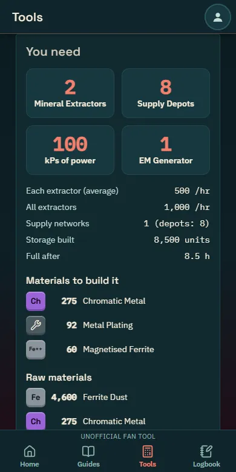
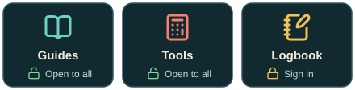
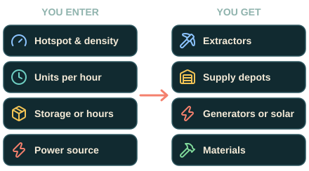
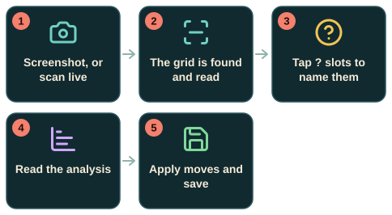
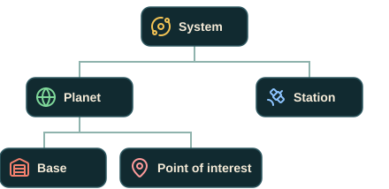
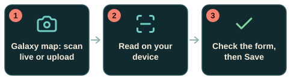
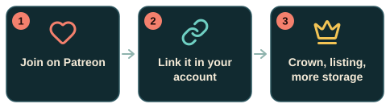
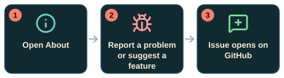

# All People Sky

**Unofficial No Man's Sky companion:** guides, calculators and a personal logbook for phone, tablet and computer.

  
  

> Unofficial fan tool. No Man's Sky is a trademark of Hello Games; this app is not affiliated with or endorsed by Hello Games.

---

##  Getting started

| | Where |
|---|---|
| **Phone** | Tabs along the bottom |
| **Tablet / computer** | Sidebar: one link per tool and logbook list (tap the **Tools** or **Logbook** heading to fold it away; remembered on this device) |
| **Account / Admin** | Avatar at the top right |
| **Language** | Flag at the top right: English, Français, Español (remembered on your account) |

##  Guides

| | |
|---|---|
|  | Pick a section chip, or **All** |
|  | Search: word beginnings match ("refin" → refiner) |

**Sort** (above the list): the suggested order, by name (A–Z), or most recent first, showing when each guide was last updated. The app remembers your choice on this device.

Some guides show only when you're signed in.

**Gallery** (the button beside the guides' heading, or under Guides in the sidebar): pictures and PDFs from the team. Each shows its name and size. Tap a picture to see it full size, step through with the arrows, and press **Download** to save it; a PDF opens in your browser, where you can read or save it. The tags at the top show one kind of item (Posters, Maps, …); **Group by tag** lists them under each tag: a tag with more than 10 shows its first 10 and a **See all** button for the rest.

##  Tools

| | Tool | What it does |
|---|---|---|
|  | **Refiner** | Every refiner recipe for a product, with amounts and time |
|  | **Recipes** | Cooking: ingredients, material tree, Nutrient Ingestor buff |
|  | **Crafting** | Material tree down to raw materials |
|  | **Solar & battery** | Panels and batteries for your base's power |
|  | **Extraction** | Extractors, depots, power and materials for a mining or gas site |
|  | **Timers** | Timers for refiners, crops, frigates and settlements, with a notification when they finish |
|  | **Planet finder** | Describe the planet you want (galaxy, star colour, race, biome, paradise, no storms, Sentinels, resources…) and get portal addresses for places you’ve never been |
|  | **Fishing** | Every fish: where and when it bites, water depth, value and the best bait; search and filter |
|  | **Creature Arena** | Best creature types against each opponent |
|  | **Circuit Tester** | Build base circuits from switches and logic parts, then test them |
|  | **Corvette parts** | Every corvette part: picture, family, what it does, its bonuses; search, filter and sort |
|  | **Tech optimisation** | Checks your tech grid layout and suggests moves |

Every tab has its own link, so you can bookmark or share it.

###  Extraction

- **Density:** the Survey Device shows it; the hotspot centre is best.
- **Advanced:** 2 extractors per network avoid the slowdown.

###  Circuit Tester

**Build**, then **Test**. Parts: power (solar, battery, reactor, generator), switches (wall, button, floor, proximity), Auto Switch, Power Inverter, and outputs (lights, noise box, sphere creator).

- **Gates:** AND, OR, NOT, NAND, NOR, XOR, XNOR and a buffer drop in as the real parts that make them, already wired, moving as one. Wire your switches to **A** and **B**, power to **+**, and a light to **Q**. **Ungroup** to change one.
- **Wiring:** tap a socket, then another (or drag between them). Wires find their own way: never behind a part, never along another wire; where two cross, a small bridge shows they aren't joined, and a dot marks where joined wires branch. Hover a socket to see what it is (P power in, C control, Q power out…). To move a wire, tap it and drag one of its round ends onto another socket.
- **Tidy:** parts snap to the grid; select several (Shift) to line them up or space them evenly. **Delete** removes what's selected. **Copy** and **Paste** (Ctrl+C, Ctrl+X, Ctrl+V; Ctrl+D duplicates) work on parts and whole gates, with the wires between them, even into another circuit.
- **Big circuits:** scroll with the mouse wheel or the scrollbars, zoom with Ctrl + wheel or a pinch.
- **Test:** tap switches and buttons. Blue wires have power, dark orange ones don't. Auto Switches and Power Inverters react one tick (about a second) later, as in game. Play, pause or step one tick.
- **Power** (day and night) and **materials** add up as you build. Wiring isn't counted.
- **Examples:** light switch, two-switch lock, two-way stair light, blinker, memory latch, and a combination lock door (a keypad of ten buttons and a 4-digit code; a wrong key starts again).
- Your circuit stays on this device; sign in to save circuits to your account. Undo with Ctrl+Z.

###  Tech optimisation

Tabs: Exosuit · Starship · Corvette · Multi-tool · Freighter · Exocraft

- **Upload a screenshot**: the grid is found and read by itself. If it landed in the wrong place, **Adjust the frame** and read again.
- **Scan live with a camera**: point this device's camera, or [your phone's](#scan-with-your-phone), at the inventory's Technology grid, then **Use this reading**.
- For the frame: set how many **rows** and **columns** the screenshot shows. The frame starts where you last put it for that inventory (same size, rows and columns), so screenshots from the same screen need no dragging.
- Icons you name are remembered on this device. Icons the app team names are recognised for everyone, on any ship.
- When you tap a **?** slot, **Most likely** lists the techs whose icon looks closest. Check the name in the game before picking.
- On starships and multi-tools the slot's border colour shows its family (red Blaze Javelin, green Mining Beam…): the picker lists that family first.
- Place the frame with the mouse, or nudge it with the arrow keys (Ctrl moves ten times as far, Shift resizes). The next screenshot of the same inventory starts with the frame where you left it.
- Mark supercharged slots on ships, corvettes, tools, exocraft and freighters. The reminder asks for as many as the class gives: 1 at C up to 4 at S (exocraft 3).
- **Corvette**: its general starship tech and upgrade modules plus its core parts (reactors, cockpit, thrusters, shields, weapons, landing gear), including the Forsaken ones. Only the first three parts of a type count (three of each reactor or weapon kind): a fourth is flagged.
- Undo is always there. Saving needs you to be signed in.
- A saved layout keeps the grid part of your screenshot, so you can name the remaining **?** slots later.

##  Logbook

Private to you (unless you share a record); needs you to be signed in.

| | |
|---|---|
|  | **+ New …** on any list; tap a name to open it. On a system's page, the **→** beside Planets or Space stations opens that list filtered to the system; on a planet's page, beside Bases or Points of interest |
|  | Search, filter, sort (cards on phones, table on computers) |
|  | Stations: record the upgrades each merchant sells |
|  | Points of interest: class, coordinates |
|  | **Spaceships**: your starships and corvettes, with type, class, pictures, **About this ship** (your text, shown to others when you share the ship) and private **Notes**. For a rare ship, **Where to find one** (galaxy, where it turns up, the system's portal address) is shown with it too. **Share** puts it in the [Spaceship showroom](#spaceship-showroom) |
|  | **Outfits**: looks you made at the Appearance Modifier: race, the parts (head or helmet, torso, legs, backpack, cape), pictures and **About this outfit**. **Share** puts it in the [Outfit Showcase](#outfit-showcase) |
|  | **Companions**: the creatures you adopted, as the Companion Registry shows them: species, native climate, gender, height, weight, personality (Playful/Helpful, Gentle/Aggressive, Devoted/Independent), Xeno Arena affinity, battle abilities (level and class, Combat Effectiveness, Agility and Health classes, Holo-Arena victories; all three S marks it **Triple S**), whether it can be ridden, where its species lives (galaxy and portal address), pictures, **About this companion** and private **Notes**. **Share** puts it in [The Zoo](#the-zoo) |
|  | **From address** (Systems): pick the galaxy and enter the 12 glyphs (tap them, or type or paste the address as hex, e.g. 217EB09D79D7). The app works out, on your device and the way the game does, the system's name and region, star colour, race, economy, wealth and conflict, every planet and moon by name with its details (biome, the discovery-page description, weather and storms, hazard, Sentinels, resources, fauna and flora, water), and its space station. **Add to my logbook** adds them all, linked; anything already there is kept. Saving a system with a galaxy and a full address (typed in, or from **Scan screen**) adds its planets, moons and station the same way, as ticked on the form. A system's page then shows its distance to the galactic centre, how many planets and moons it has, and whether it holds the region's black hole or Atlas Interface |
|  | **QR code** on any record's page: scan it with your phone to open that record. A shared record's code opens its public page, so anyone can scan it; a private one's opens it in your own logbook. **Download** saves the code as a picture |
|  | **Share** on any record's page puts it on the public [Discoveries](#discoveries) page, under your display name, with its own link to send to friends. A system can take its planets and stations along, a planet its bases and points of interest. Your notes stay private. Press **Shared** to copy the link or **Make private** again |
|  | **More pictures**: planets, space stations, bases, points of interest, spaceships and outfits take up to 10 pictures each (the screenshot plus 9 more). Open one and step through them with **‹ Previous** / **Next ›** or the arrow keys. Shared records show them all to everyone |
|  | **Screenshot** on any record: its portal glyphs, galaxy and names are read and filled in. It's linked to the planet or system with the same address; a missing one is added for you, with the game's own names for that address (a name the screen shows wins), and you can tick **Add every planet and moon** and **Add the system's space station**. The same system is never added twice. The areas it read are marked on the picture: move, resize or delete a box, or add one, and read again |

**What the address can't tell:** the exact spectral class (only the star colour) and a station's guild. Add those from the galaxy map or the station, or a screenshot. Names are the game's originals, not ones other players uploaded.

**Planet details:** open **Planet details** on a planet's form to see or change them; **Fill in from the address** fills the empty ones (the planet's system needs a galaxy). A screenshot with the planet's glyphs fills them too. Nothing you typed is replaced.

**Scan glyphs:** wherever you enter a portal address, **Scan glyphs with a camera or picture** reads the 12 glyphs (and the galaxy under them in photo mode) with this device's camera, [your phone's](#scan-with-your-phone) or a screenshot. Point at just the glyphs: the rest of the screen doesn't matter.

###  Scan with your phone

**Playing on your phone?** No computer needed: open the site (or the installed app) on the phone, sign in and pick **This device's camera** in any scan. It uses the phone's own camera.

Scanning on a computer? Use your phone as its camera:

1. On the computer, open any scan (for example **Missions** → **Set up the camera**). Under **Use your phone as the camera** the window shows a **QR code**.
2. Scan the code with your phone's camera app (or open allpeoplesky.com on it) and **sign in with the same account**: the window names it.
3. Leave the app open on the phone, screen on (any page). A few seconds later the phone's button appears in the computer's window: pick it. The phone's camera opens by itself (allow it the first time).
4. Point the phone at the game. What it reads shows on the computer.

Phone not showing up? Check both show the same name under the round picture at the top right, and that the app is on the phone's screen (a locked phone breaks the link; it reconnects by itself). The **Use Your Phone as a Camera** guide has every step and fix.

Keep the app on the phone's screen while it scans. The phone reads the screen itself and sends only what it read, with a small preview, to your own devices.

**Glyphs in photo mode:** take the screenshot with your platform's own capture (for example Steam's F12). The game's camera leaves the glyphs out. The galaxy name under the glyphs is read too, so the names match your galaxy. Glyphs marked in amber need checking against the picture; corrections are remembered on your device.

###  Scan screen (Systems)

**Scan live with a camera** reads the galaxy map through this device's camera or [your phone's](#scan-with-your-phone).

The panel and any glyphs it finds are marked on the picture, as with screenshots: move, resize or delete a box, or add one, and read again. For a game language other than English, choose it in the scan dialog.

##  Discoveries

Records other travellers have shared: systems, planets, space stations, bases and points of interest, with their glyphs, details and screenshots. Filter by kind and galaxy, or search a name or a traveller. Each one has its own page and link; linked shared records (a system's planets, a planet's bases) are listed on it. No account needed to look. Signed in, you can **Report** a shared record that breaks the rules, and an admin takes a look.

##  Timers

**Tools → Timers** (signed in): start a timer for a refiner, a crop, a frigate expedition, a settlement or anything else, and get a **notification** when it's done, even with the app closed. The Refiner's **Start timer** button fills one in for you. Turn notifications on once on each device (**Turn on notifications**, then **Send a test**). On iPhone and iPad they only work in the installed app (iOS 16.4 or later). Your timers show on every device you sign in on. With the app open you can also have it **beep**, or **say which timer finished** out loud (each is a tick box, kept on that device).

##  Spaceship showroom

Starships and corvettes other travellers have shared from **Logbook → Spaceships**: big pictures, type and class, and what their owners wrote about them. Filter by type, sort by newest, top rated or most comments, or search a name or a traveller. No account needed to look. Signed in, you can **rate** a ship from 1 to 5 stars and **comment** on it. Shared **space stations** and **bases** on the Discoveries page take ratings and comments too. You can't rate your own; you can delete your comments, and comments left on your records.

##  Outfit Showcase

Outfits other travellers have shared from **Logbook → Outfits**: their pictures, race, parts and what their owners wrote. Filter by race, sort by newest, top rated or most comments, or search. Signed in, you can **rate** an outfit from 1 to 5 stars and **comment** on it, like the ships in the Spaceship showroom.

##  The Zoo

Companions other travellers have shared from **Logbook → Companions**: their pictures, species, native climate, personality and where to find their species. Filter by native climate or show **Triple S only**, sort by newest, top rated or most comments, or search. Signed in, you can **rate** a companion and **comment** on it.

On a computer, Discoveries, the Spaceship showroom, the Outfit Showcase and The Zoo are together under **Pathfinders** in the side menu; on a phone they're under **More**.

##  Missions

**Campaigns** (phases of missions) and standalone **missions**, each with a difficulty from ★ to ★★★★★. Play them in the game, then prove each mission in the app:

| | |
|---|---|
|  | **Scan a medal page**: raise a medal on a Catalogue & Guide page (e.g. Pirates Killed on the Mercenaries Guild page). The app asks you to scan the page when you start, and again to check |
|  | **Go there**: travel to a portal address and scan its glyphs (photo mode shows them) |
|  | **Answer a question** about the planet or system at an address: what kind of planet, its Sentinels, its economy… |
|  | **Find a secret message** the campaign's author left in the game (a beacon, a Communication Station, a sign on a base) and type it in. Capitals and punctuation don't matter; a wrong message waits 30 seconds before the next try |
|  | **Units, Nanites, Quicksilver**: earn or spend an amount, or reach a total. Scan any inventory or Catalogue & Guide screen (the figures at the top left) |
|  | **Elements**: collect, use up or carry an amount of an element (Carbon, Oxygen…) in your **exosuit**. Scan your exosuit inventory with its Cargo in view: the app reads each element's tag (C, O2, CO2…) and amount |
|  | **Bases, space stations, outfits and spaceships**: have or add a number of them in your **Logbook** (space stations you own, records with a picture, or ones you've shared, if the mission says so). **Check my logbook** counts them |

**Played like a game:** pressing **Start the campaign** (or **Continue the campaign**) opens the **ATLAS**, full screen. It plays the campaign's intro video, or shows and reads out its story, then each phase's and mission's intro the same way. For each screen the app needs to read, the ATLAS asks you to show it ("Show me the Explorers Guild page…") with the camera picture in the middle, and moves on by itself once it's read. When a mission is waiting for you, go and do it in the game, then press **Check** when you're back. Finishing a mission, a phase or the campaign plays its outro. **Leave** any time: Continue picks up where you were. **▶ Intro**, **▶ Outro** and **▶ Ending** buttons on the campaign page replay anything you've reached.

Scan with this device's camera (on a phone or tablet, its own camera: you can play missions on your phone alone), your phone's camera from a computer (signed in on both) or a screenshot. You get 3 seconds to aim (counted down on the picture, or press **Take the picture now**), then hold the camera still for under a second: when it says **you can lower the phone**, it has its picture and reads it on its own. Holding the phone upside down works too. Corners on the camera picture show roughly where the game screen goes: just keep the whole screen in view. Camera too far away? Press **+** on the picture to zoom until the screen fills the corners (**−** zooms out; the zoom is remembered on that device). A very bright TV is toned down by itself: while you aim, the camera lowers its exposure until the screen isn't washed out (in Chrome; kept for next time). You can leave the camera in one place (on a table facing the TV, say): the app finds the money, the medals, the Cargo and the glyphs wherever they are on the screen. **Set up the camera** at the top of the Missions page lets you place it once and test a picture before you need it. If some figures aren't read, it takes another picture by itself (at most 3). On a phone the camera picture goes full screen by itself (if the browser asks for a tap first, tap the picture once). One scan of a page checks every mission that counts a medal on it, and the start asks for each page once. Each mission counts from its own starting total, taken when it opens (missions in a phase marked *in order* open one at a time, so the app may ask for a quick scan between them). Every starting total must be read for the campaign to start: if you cancel a scan, or a total can't be read, it stops there and tells you what's missing. As soon as the right screen is read, the scan moves on by itself, and your starting totals are shown on the campaign page. Phases open one after another; **Restart this phase** clears it and the phases after it (with their badges) and scans your starting totals again. Each finished phase and campaign gives a **badge**, marked Common to Legendary by how many players earned it. On a campaign's page the phases sit in a row of round patches (tap one to see its missions, ticked off as you go), with the **leaderboard** below: players who finished come first, fastest first, then everyone else by how much they've done (admins, who test campaigns, aren't listed). **Spoken prompts** ("Mission successful", "Phase 2 completed") can be turned off at the top of the Missions page. On the Missions tab, **Draw a random mission** gives you one of your own at the difficulty you pick. **Give up** deletes your progress in a campaign. Each campaign shows who made it and how many times it was played; rate the ones you've played with 1–5 stars. **My campaigns** lets you make your own for other players: build it as a draft, **Test run** it (with a **Pass test** button on every check), then publish it. See the guides *Playing Campaigns and Missions* and *Creating Your Own Campaigns*.

##  News

New features and important changes appear under **News** on the home page. Want them by e-mail? Turn on **News by e-mail** on your Account page (on unless you turn it off; turn it off there at any time).

##  Account

**Create account** · **Sign in** · **Continue with Google** · **Forgot password?** · **Sign out**. All of these are in the avatar menu at the top right. Google sign-in with the same e-mail address as an existing account opens that account.

**Delete my account** (bottom of the Account page, or the [Delete your account](https://allpeoplesky.com/delete-account) page) removes your account, your whole logbook and your screenshots. Type your e-mail address to confirm. Can't sign in any more? That page says how to ask us by e-mail.

**Install it like an app:** in Chrome or Edge use "Install app"; on an iPhone use Share → "Add to Home Screen". The **Install the App** guide shows every phone, tablet and computer step by step. Hold the installed icon (or right-click it on a computer) to jump straight to the Logbook, Refiner, Discoveries or Guides. Guides and tools you have opened keep working without a connection, and the app tells you when a new version is ready.

##  Heroes

The app is free, and supporters on Patreon keep it running.

In your account you can hide yourself from the Heroes page or change the name it shows.

##  Feedback

Include the **version and build** shown on the About page. You'll need a free GitHub account. You can also [open an issue](https://github.com/tapaccos2/AllPersonSky/issues) directly.

No GitHub account? Use **Send us a message** on the About page: type your e-mail address and message, and we reply by e-mail.

##  Privacy

| | |
|---|---|
|  | Logbook and saved layouts: only you can see them, unless you share a record (never its notes) |
|  | Screen scans and grid photos: read on your device; a saved layout keeps only the grid part, privately. Scanning with your phone sends what it read, and a small preview, only to your own devices, and nothing is stored |
|  | Logbook screenshots: read on your device, stored only if you save one |

No ads, no analytics, no tracking cookies. The full policy is the **Privacy** page in the app (About → Privacy policy).

Game data comes from the [No Man's Sky Wiki](https://nomanssky.fandom.com/) (CC BY-SA), with the newest items and charts from [No Man's Sky Resources](https://www.nomansskyresources.com). If something looks wrong after a patch, please report it.

---

*Found a problem or have an idea? [Open an issue](https://github.com/tapaccos2/AllPersonSky/issues) (a free GitHub account is needed).*
